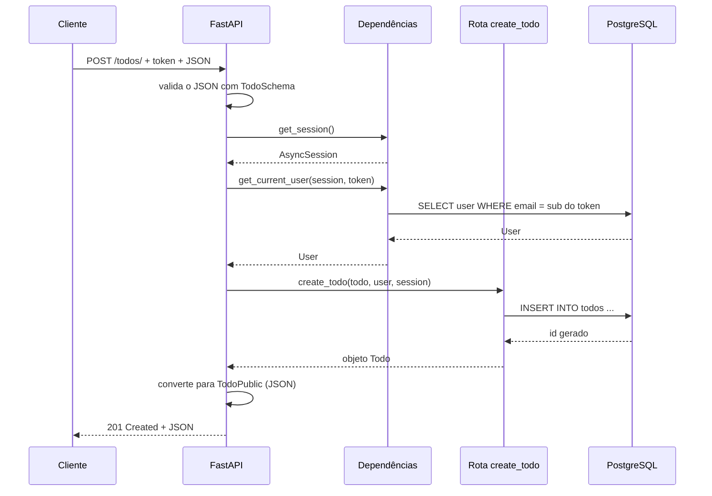

# Guia de estudo do Fast Zero

Este guia explica **como o projeto funciona** e **para que serve cada
tecnologia**, sempre apontando onde ver aquilo no código. Ele complementa
o [README](../README.md), que mostra como instalar e rodar.

Sugestão de leitura: comece pela seção 1 (o caminho de uma requisição),
que liga todas as peças, e depois vá às tecnologias que quiser
aprofundar.

## Sumário

1. [O caminho de uma requisição](#1-o-caminho-de-uma-requisição)
2. [Tecnologias](#2-tecnologias)
   - [FastAPI](#fastapi)
   - [Pydantic (schemas)](#pydantic-schemas)
   - [SQLAlchemy (banco de dados)](#sqlalchemy-banco-de-dados)
   - [async/await](#asyncawait)
   - [Alembic (migrações)](#alembic-migrações)
   - [Autenticação: hash de senha e JWT](#autenticação-hash-de-senha-e-jwt)
   - [Configurações (pydantic-settings)](#configurações-pydantic-settings)
   - [Testes (pytest)](#testes-pytest)
   - [Docker e Docker Compose](#docker-e-docker-compose)
   - [uv (dependências)](#uv-dependências)
   - [ruff e taskipy](#ruff-e-taskipy)
   - [GitHub Actions (CI)](#github-actions-ci)
3. [Mapa dos arquivos](#3-mapa-dos-arquivos)
4. [Exercícios](#4-exercícios)

---

## 1. O caminho de uma requisição

Vamos seguir um `POST /todos/` (criar uma tarefa) do começo ao fim:

```http
POST /todos/
Authorization: Bearer eyJhbGciOi...
Content-Type: application/json

{"title": "Estudar", "description": "Ler o guia", "state": "todo"}
```



Passo a passo:

1. **Roteamento** (`app.py`): o FastAPI encontra a rota pelo método e
   caminho. O prefixo `/todos` vem do `APIRouter(prefix="/todos")` em
   `routers/todos.py`, registrado com `app.include_router`.
2. **Validação da entrada** (`schemas/todo.py`): a rota declara
   `todo: TodoSchema`. O FastAPI lê o JSON e o Pydantic valida. Se faltar
   um campo ou o `state` for inválido, a resposta é **422** e a rota nem
   chega a rodar.
3. **Dependências** (`dependencies.py`): os parâmetros `T_Session` e
   `T_CurrentUser` fazem o FastAPI chamar `get_session()` (abre a sessão
   com o banco) e `get_current_user()` (valida o token e busca o
   usuário). Sem token válido, a resposta é **401**.
4. **A rota** (`create_todo`): cria o objeto `Todo`, faz
   `session.add()`, `await session.commit()` (grava no banco) e
   `await session.refresh()` (lê de volta o `id` gerado).
5. **Saída** (`response_model=TodoPublic`): o FastAPI converte o objeto
   do banco no schema de resposta. Só os campos do schema vão para o
   JSON.
6. **Final da requisição**: o `async with` dentro de `get_session()`
   fecha a sessão e devolve a conexão ao pool.

Esse mesmo roteiro se repete em todas as rotas; muda só o que a rota faz
no passo 4.

---

## 2. Tecnologias

### FastAPI

**O que é:** framework web para criar APIs. Você escreve funções Python
comuns, e ele cuida de HTTP, validação, conversão para JSON e
documentação.

**Onde ver:** `app.py` e `routers/`.

**Conceitos principais:**

- **Rota**: uma função decorada com o método e o caminho:

  ```python
  @router.post("/", status_code=HTTPStatus.CREATED, response_model=TodoPublic)
  async def create_todo(todo: TodoSchema, user: T_CurrentUser, session: T_Session):
  ```

- **De onde vem cada parâmetro**: o FastAPI decide pelo tipo e pelo
  nome:
  - `todo_id: int` com `{todo_id}` no caminho → **path parameter**
    (`/todos/5`);
  - um schema Pydantic → **corpo** da requisição (JSON);
  - `Annotated[FilterTodo, Query()]` → **query string**
    (`?title=abc&limit=10`);
  - `Annotated[Tipo, Depends(função)]` → **dependência** (veja abaixo).
- **Injeção de dependências** (`Depends`): em vez de a rota criar a
  sessão do banco ou buscar o usuário, ela declara que precisa deles, e o
  FastAPI chama as funções e entrega o resultado. Isso deixa as rotas
  curtas e permite trocar a dependência nos testes
  (`dependency_overrides`). Os apelidos `T_Session`, `T_CurrentUser` e
  `T_OAuth2Form` ficam em `dependencies.py`.
- **`response_model`**: define o formato da resposta e filtra os campos.
  É por isso que a senha nunca aparece no JSON: `UserPublic` não tem o
  campo `password`.
- **`HTTPException`**: interrompe a rota e devolve um erro com status e
  mensagem, como em `get_user_todo()`, que levanta 404.
- **Documentação automática**: em <http://localhost:8000/docs> está o
  Swagger, gerado a partir das rotas e dos schemas. Dá para testar todas
  as rotas por ali.

### Pydantic (schemas)

**O que é:** biblioteca de validação de dados. Você declara uma classe
com campos tipados, e ela valida e converte os dados que chegam.

**Onde ver:** `schemas/`.

**Conceitos principais:**

- **`BaseModel`**: cada schema é uma classe com tipos:

  ```python
  class UserSchema(BaseModel):
      username: str
      email: EmailStr     # valida o formato do email
      password: str
  ```

- **Schemas de entrada e de saída**: `UserSchema` (o que o cliente
  envia, com senha) e `UserPublic` (o que a API devolve, sem senha).
- **`from_attributes=True`** (em `UserPublic`): permite criar o schema a
  partir de um objeto do SQLAlchemy, lendo os atributos (`user.id`,
  `user.email`...).
- **Campos opcionais**: `title: str | None = None` em `TodoUpdate`. O
  `model_dump(exclude_unset=True)` no PATCH devolve só os campos que o
  cliente realmente enviou, então os outros não são alterados.
- **Restrições com `Field`**: em `schemas/filter.py`,
  `limit: int = Field(default=100, ge=1, le=100)` aceita só valores entre
  1 e 100; fora disso, a resposta é 422.
- **Herança**: `FilterTodo` herda `offset` e `limit` de `FilterPage`.

**Model x schema:** o *model* (SQLAlchemy) representa a **tabela**; o
*schema* (Pydantic) representa o **JSON da API**. Eles costumam ser
parecidos, mas têm papéis diferentes, e manter os dois separados é o
que permite, por exemplo, esconder a senha.

### SQLAlchemy (banco de dados)

**O que é:** biblioteca para trabalhar com bancos relacionais em Python.
O projeto usa o **ORM**: tabelas viram classes e linhas viram objetos.

**Onde ver:** `models.py` (tabelas), `database.py` (conexão) e as
queries nos `routers/`.

**Engine e sessão** (`database.py`):

- **Engine** (`create_async_engine`): sabe como se conectar ao banco e
  mantém um **pool** de conexões abertas para reaproveitar. É criado uma
  vez só.
- **Sessão** (`AsyncSession`): a "conversa" com o banco durante uma
  requisição. Ela acumula as mudanças (`add`, alterações em atributos,
  `delete`) e grava tudo de uma vez no `commit()`, numa **transação**: ou
  grava tudo, ou nada.
- **`expire_on_commit=False`**: por padrão, depois do commit, a sessão
  "esquece" os valores dos objetos e recarrega na próxima leitura. Em
  async essa recarga implícita não é permitida, então desligamos.

**Models** (`models.py`):

```python
@table_registry.mapped_as_dataclass
class Todo:
    __tablename__ = "todos"

    id: Mapped[int] = mapped_column(init=False, primary_key=True)
    title: Mapped[str]
    state: Mapped[TodoState]
    user_id: Mapped[int] = mapped_column(ForeignKey("users.id"))
```

- `Mapped[str]` vira uma coluna `NOT NULL`; `nullable=True` permite
  nulo.
- `mapped_as_dataclass` gera o construtor: `Todo(title=..., ...)`.
  `init=False` tira o campo do construtor porque quem preenche é o banco
  (`id`, `created_at`).
- `server_default=func.now()`: o próprio banco preenche a data na
  inserção. `onupdate=func.now()` atualiza a data a cada alteração.
- **Relacionamentos**: `User.todos` e `Todo.user` ligam as duas tabelas
  pela chave estrangeira `user_id`. `back_populates` conecta os dois
  lados. `cascade="all, delete-orphan"` faz a exclusão de um usuário
  apagar os todos dele. `lazy="selectin"` carrega os todos junto com o
  usuário (veja [async/await](#asyncawait)).
- `TodoState(StrEnum)`: no banco vira um tipo `ENUM` do Postgres, que só
  aceita os valores listados.

**Queries** (nos `routers/`):

```python
query = select(Todo).where(Todo.user_id == user.id)
query = query.where(Todo.title.contains("abc"))      # LIKE '%abc%'
query = query.order_by(Todo.id).offset(0).limit(10)  # paginação

todo = await session.scalar(query)               # um resultado (ou None)
todos = (await session.scalars(query)).all()     # lista de resultados
```

A query é montada aos poucos e só vai ao banco no `await`. Por isso dá
para adicionar filtros com `if`, como em `list_todos`.

### async/await

**O que é:** um jeito de o servidor atender várias requisições ao mesmo
tempo com uma única thread. Enquanto uma requisição espera o banco
responder, o **event loop** atende outra.

**Onde ver:** todas as rotas são `async def`; toda ida ao banco tem
`await`.

**Regras práticas:**

- `await` só funciona dentro de `async def`.
- Tudo que espera algo externo (banco, rede) leva `await`:
  `await session.commit()`, `await session.scalar(...)`.
- **Não bloqueie o event loop.** Código que ocupa a CPU por muito tempo
  trava todas as requisições. O hash de senha (argon2) é pesado de
  propósito, então ele roda numa thread separada com
  `run_in_threadpool` (`utils/security.py`).
- **Sem lazy loading implícito.** No modo síncrono, acessar `user.todos`
  faria uma query escondida. Em async isso é proibido, porque toda ida ao
  banco precisa de `await`. Por isso `User.todos` usa `lazy="selectin"`:
  os todos já vêm carregados junto com o usuário.
- O driver **psycopg 3** funciona nos modos síncrono e async com a mesma
  URL (`postgresql+psycopg://...`). A aplicação usa o modo async e o
  Alembic usa o síncrono.
- No Windows, o psycopg async não funciona com o event loop padrão
  (Proactor). Os testes usam o `SelectorEventLoop`; veja
  `pytest_asyncio_loop_factories` em `tests/conftest.py`.

### Alembic (migrações)

**O que é:** ferramenta que versiona a **estrutura do banco**. Cada
mudança nas tabelas vira um arquivo de migração, como um commit do git
para o schema do banco.

**Onde ver:** `migrations/versions/` (as migrações), `migrations/env.py`
(configuração) e `alembic.ini`.

**Como funciona:**

- Cada migração tem um `upgrade()` (aplica a mudança) e um
  `downgrade()` (desfaz), além de um `revision` e um `down_revision`
  (a migração anterior). Isso forma uma corrente:

  ```
  bd874d4d683d  cria users e todos
        ↓
  8c66d73321e6  adiciona created_at/updated_at
        ↓
  e36ad7ab3e8e  converte todos.state para ENUM
  ```

- O banco guarda a versão atual na tabela `alembic_version`. O
  `alembic upgrade head` aplica só as migrações que faltam.
- O `env.py` lê a `DATABASE_URL` do `settings` e usa o
  `table_registry.metadata` dos models. É assim que o autogenerate sabe
  como as tabelas *deveriam* ser.

**Comandos:**

```bash
uv run alembic revision --autogenerate -m "descrição"  # gera a migração
uv run alembic upgrade head                            # aplica
uv run alembic downgrade -1                            # desfaz a última
uv run alembic current                                 # versão atual do banco
uv run alembic check                                   # models e banco batem?
```

**Cuidados:**

- **Sempre revise a migração gerada.** O autogenerate compara os models
  com o banco, mas não entende tudo. Exemplo real deste projeto: na
  migração `e36ad7ab3e8e`, foi preciso criar o tipo `ENUM` e converter os
  dados existentes à mão (`postgresql_using='state::todostate'`).
- Nunca edite uma migração que já foi aplicada em outro banco; crie uma
  nova.
- Os testes não usam o Alembic: eles criam as tabelas direto dos models
  (`metadata.create_all`). Por isso o `alembic check` é importante, para
  garantir que os dois caminhos geram o mesmo schema.

### Autenticação: hash de senha e JWT

**Onde ver:** `utils/security.py` e `routers/auth.py`.

**Hash de senha (pwdlib + argon2):**

- A senha **nunca** é guardada em texto. `get_password_hash()` gera um
  hash irreversível, e `verify_password()` compara a senha digitada com o
  hash.
- O argon2 é lento de propósito, para dificultar ataques de força bruta.
- O hash inclui um *salt* aleatório: a mesma senha gera hashes
  diferentes a cada vez.

**JWT (JSON Web Token):**

Um JWT tem três partes separadas por ponto: `cabeçalho.payload.assinatura`.

```json
{"sub": "alice@example.com", "exp": 1763337600}
```

- **`sub`** (*subject*): quem é o dono do token. Aqui, o email.
- **`exp`**: quando o token expira (`ACCESS_TOKEN_EXPIRE_MINUTES`).
- **Assinatura**: gerada com a `SECRET_KEY` e o algoritmo `HS256`. Quem
  não tem a chave não consegue alterar o payload sem invalidar o token.
  O payload **não é criptografado**: qualquer um consegue lê-lo (teste
  em <https://jwt.io>). Por isso nunca coloque dados sensíveis nele.

**O fluxo:**

1. `POST /auth/token` com email e senha (formulário OAuth2: o campo se
   chama `username`, mas recebe o email).
2. Se a senha confere, a API devolve um `access_token`.
3. Nas próximas requisições, o cliente envia
   `Authorization: Bearer <token>`.
4. `get_current_user()` valida a assinatura e a expiração, lê o `sub` e
   busca o usuário. Qualquer falha gera 401.
5. `POST /auth/refresh_token` troca um token ainda válido por um novo,
   com a expiração renovada.

**Detalhes de segurança no código:**

- O login responde com a mesma mensagem para "email não existe" e
  "senha errada", para não revelar quais emails estão cadastrados.
- `PUT` e `DELETE /users/{id}` conferem se o `id` é o do usuário logado
  (senão, 403).
- As rotas de todos sempre filtram por `Todo.user_id == user.id`: um
  usuário nunca enxerga os todos de outro.

### Configurações (pydantic-settings)

**Onde ver:** `settings.py`, `.env.example` e `compose.yaml`.

- `Settings` é um schema Pydantic que lê os valores de **variáveis de
  ambiente** ou do arquivo **`.env`**. Se faltar alguma, a aplicação nem
  inicia, o que é melhor do que falhar no meio de uma requisição.
- Existe uma instância única, `settings`, importada onde for preciso.
- O `.env` tem segredos e fica fora do git (`.gitignore`). O
  `.env.example` é o modelo versionado.
- No Docker, o `compose.yaml` carrega o `.env` e **sobrescreve** a
  `DATABASE_URL`, porque dentro da rede do compose o banco não é
  `localhost`: é o nome do serviço, `fastzero_database`.

### Testes (pytest)

**Onde ver:** `tests/`, especialmente `tests/conftest.py`.

**Conceitos principais:**

- **Teste**: qualquer função `test_*` em arquivos `test_*.py`. Os
  `assert` verificam o resultado.
- **Fixtures**: funções que preparam o que o teste precisa. O teste
  "pede" uma fixture pelo nome do parâmetro:

  ```python
  async def test_delete_todo(session, client, user, token):
  ```

  O pytest cria `session`, `client`, `user` e `token` antes do teste. As
  fixtures do `conftest.py` ficam disponíveis para todos os testes, sem
  import.
- **Escopo**: `database_url` tem `scope="session"`, então o Postgres
  sobe uma vez só por execução. As outras fixtures são recriadas a cada
  teste.
- **Isolamento**: a fixture `session` cria as tabelas antes de cada
  teste e as apaga depois. Um teste nunca enxerga os dados de outro.

**Ferramentas usadas:**

| Ferramenta | Papel |
|---|---|
| **pytest-asyncio** | permite testes `async def` (modo `auto` no `pyproject.toml`) |
| **testcontainers** | sobe um Postgres 18 temporário no Docker só para os testes |
| **httpx `AsyncClient`** | faz requisições à API; o `ASGITransport` chama a aplicação direto, sem abrir um servidor |
| **`app.dependency_overrides`** | troca a `get_session` real pela sessão do teste |
| **factory-boy** | cria objetos de teste com dados automáticos (`UserFactory`, `TodoFactory`) |
| **freezegun** | "congela" o relógio, para testar a expiração do token sem esperar 30 minutos |
| **pytest-cov** | mede quais linhas os testes executaram (cobertura) |

**Comandos úteis:**

```bash
uv run task test                         # lint + todos os testes + cobertura
uv run pytest tests/test_todos.py        # só um arquivo
uv run pytest -k patch                   # só os testes com "patch" no nome
uv run pytest -x                         # para no primeiro erro
```

O relatório de cobertura em HTML fica em `htmlcov/index.html`.

### Docker e Docker Compose

**O que é:** o Docker empacota a aplicação com tudo que ela precisa
(sistema, Python, dependências) numa **imagem**. Um **container** é uma
imagem rodando. O Compose sobe vários containers juntos.

**Onde ver:** `Dockerfile`, `compose.yaml`, `entrypoint.sh` e
`.dockerignore`.

**`Dockerfile`** (receita da imagem da aplicação):

1. Parte da imagem oficial `python:3.14-slim` e copia o binário do uv.
2. Copia **só** `pyproject.toml`, `uv.lock` e `.python-version` e
   instala as dependências. Como cada instrução gera uma **camada** com
   cache, alterar o código não reinstala as dependências: só alterar o
   `uv.lock` faz isso.
3. Copia o código (`COPY . .`). O `.dockerignore` impede a cópia de
   `.git`, `.venv`, `.env` e caches.
4. Define o `entrypoint.sh` como o comando inicial.

**`entrypoint.sh`**: roda as migrações e depois inicia a API. O `set -e`
para o container se a migração falhar. O `exec` faz o servidor virar o
processo principal, para receber o sinal de desligar do Docker.

**`compose.yaml`** (os dois serviços):

- `fastzero_database`: Postgres 18. Os dados ficam no **volume**
  `pgdata`, que sobrevive a `docker compose down`. O `healthcheck` usa o
  `pg_isready` para saber quando o banco está aceitando conexões.
- `fastzero_app`: a API, construída a partir do `Dockerfile`. O
  `depends_on` com `condition: service_healthy` espera o banco ficar
  pronto antes de subir.
- Os serviços se enxergam pelo nome, numa rede criada pelo compose.

**Comandos:**

```bash
docker compose up --build        # constrói e sobe (Ctrl+C para parar)
docker compose up -d             # sobe em segundo plano
docker compose logs -f fastzero_app
docker compose exec fastzero_database psql -U <usuario> -d <banco>
docker compose down              # para e remove os containers (mantém o volume)
docker compose down -v           # também apaga o volume (dados do banco)
```

### uv (dependências)

**O que é:** gerenciador de projetos Python. Instala o Python, cria o
ambiente virtual, resolve e trava as versões das dependências.

**Arquivos:**

| Arquivo | Papel |
|---|---|
| `pyproject.toml` | dependências que o projeto **aceita** (`fastapi>=0.163.1`) e configurações das ferramentas |
| `uv.lock` | versões **exatas** instaladas, para todo mundo ter o mesmo ambiente. Gerado pelo uv, não edite à mão |
| `.python-version` | versão do Python do projeto (3.14) |
| `.venv/` | o ambiente virtual (fora do git) |

As dependências de desenvolvimento (pytest, ruff...) ficam no grupo
`dev` em `[dependency-groups]`. Elas não vão para a imagem Docker
(`uv sync --no-dev`).

**Comandos:**

```bash
uv sync                    # instala tudo conforme o uv.lock
uv add httpx               # adiciona uma dependência
uv add --dev pytest-mock   # adiciona uma dependência de desenvolvimento
uv remove httpx            # remove
uv lock --upgrade          # atualiza todas para as versões mais novas permitidas
uv run <comando>           # roda um comando dentro do .venv
```

### ruff e taskipy

- **ruff**: verifica o estilo e erros comuns (**lint**) e formata o
  código. As regras ficam em `[tool.ruff]` no `pyproject.toml`: linhas
  de até 79 caracteres, imports ordenados (`I`), erros do Pyflakes (`F`),
  estilo PEP 8 (`E`, `W`), regras do Pylint (`PL`) e de pytest (`PT`).
- **taskipy**: atalhos para comandos longos, definidos em
  `[tool.taskipy.tasks]`. O prefixo `pre_` roda antes e o `post_` roda
  depois: `task test` executa `lint`, depois os testes, depois o
  relatório HTML de cobertura.

### GitHub Actions (CI)

**Onde ver:** `.github/workflows/pipeline.yaml`.

A cada `push` ou pull request, o GitHub cria uma máquina Linux, instala
o uv e o Python, roda `uv sync --locked` e `uv run task test`. Se algo
falhar, o commit fica marcado com ❌ no GitHub. As variáveis de ambiente
vêm dos **secrets** do repositório (Settings → Secrets and variables →
Actions), nunca do código.

Pelo terminal: `gh run list` e `gh run watch`.

---

## 3. Mapa dos arquivos

### Código da aplicação (`fast_zero/`)

| Arquivo | Para que serve |
|---|---|
| `app.py` | cria o `FastAPI` e registra os routers |
| `settings.py` | lê as configurações do ambiente/`.env` |
| `database.py` | engine e `get_session()` (sessão por requisição) |
| `models.py` | tabelas `User` e `Todo` e o enum `TodoState` |
| `dependencies.py` | apelidos das dependências usadas nas rotas |
| `routers/auth.py` | login e refresh do token |
| `routers/users.py` | CRUD de usuários |
| `routers/todos.py` | CRUD e filtros das tarefas |
| `schemas/user.py` | JSON de entrada/saída de usuários |
| `schemas/todo.py` | JSON de entrada/saída de tarefas e filtros |
| `schemas/token.py` | resposta do login |
| `schemas/filter.py` | paginação (`offset`/`limit`) |
| `utils/security.py` | hash de senha, criação e validação do JWT |
| `__init__.py` | marca a pasta como pacote Python (pode ficar vazio) |

### Banco e migrações

| Arquivo | Para que serve |
|---|---|
| `alembic.ini` | configuração do Alembic (pasta das migrações, logs) |
| `migrations/env.py` | conecta o Alembic ao banco e aos models |
| `migrations/script.py.mako` | modelo usado para gerar novas migrações |
| `migrations/versions/*.py` | as migrações, em ordem |

### Testes (`tests/`)

| Arquivo | O que testa |
|---|---|
| `conftest.py` | fixtures e factories compartilhadas |
| `test_app.py` | rota raiz |
| `test_auth.py` | login, refresh e expiração do token |
| `test_users.py` | CRUD de usuários e permissões |
| `test_todos.py` | CRUD, filtros e paginação de tarefas |
| `test_security.py` | JWT e `get_current_user` |
| `test_db.py` | models direto no banco |

### Configuração e infraestrutura

| Arquivo | Para que serve |
|---|---|
| `pyproject.toml` | dependências e configuração de ruff, pytest, pyright e taskipy |
| `uv.lock` | versões exatas das dependências |
| `.python-version` | versão do Python |
| `.env` / `.env.example` | variáveis de ambiente (o real fica fora do git) |
| `Dockerfile` | receita da imagem da aplicação |
| `compose.yaml` | sobe a aplicação e o Postgres juntos |
| `entrypoint.sh` | roda as migrações e inicia a API no container |
| `.dockerignore` | o que **não** copiar para a imagem |
| `.gitignore` | o que **não** versionar no git |
| `.gitattributes` | força quebra de linha LF em scripts (o CRLF do Windows quebra o shell do container) |
| `.github/workflows/pipeline.yaml` | CI: roda lint e testes a cada push |

---

## 4. Exercícios

Cada exercício passa por várias camadas do projeto. Rode
`uv run task test` ao final de cada um.

1. **Novo filtro.** Permita filtrar os todos por data de criação:
   `GET /todos/?created_after=2026-01-01`.
   *Dica:* adicione o campo em `FilterTodo` (tipo `date | None`) e um
   `if` em `list_todos` com `Todo.created_at >= ...`. Escreva um teste.

2. **Novo campo com migração.** Adicione um campo opcional `due_date`
   (prazo) ao `Todo`.
   *Dica:* altere o model, gere a migração com `--autogenerate`, revise o
   arquivo, aplique com `upgrade head` e confira com `alembic check`.
   Depois inclua o campo nos schemas (`TodoSchema`, `TodoUpdate`) e nos
   testes.

3. **Rota de detalhe.** Crie `GET /todos/{todo_id}`, que devolve um
   todo do usuário ou 404.
   *Dica:* a função `get_user_todo()` já faz quase tudo.

4. **Rota "meu perfil".** Crie `GET /users/me`, que devolve o usuário
   logado.
   *Dica:* basta `T_CurrentUser` e `response_model=UserPublic`.

5. **Contagem por estado.** Crie `GET /todos/stats`, que devolve quantos
   todos o usuário tem em cada estado, como
   `{"todo": 3, "done": 5}`.
   *Dica:* `select(Todo.state, func.count()).group_by(Todo.state)`.
   Se você fez o exercício 3, declare esta rota **antes** de
   `GET /todos/{todo_id}`: o FastAPI testa as rotas na ordem, e
   `/todos/stats` casaria com `{todo_id}` (e daria 422, pois `stats` não
   é um número).

6. **Validação de senha.** Exija senha com pelo menos 8 caracteres no
   cadastro.
   *Dica:* `Field(min_length=8)` em `UserSchema`. Veja quais testes
   quebram e por quê.

7. **Explorando o async.** Em uma rota de teste, use
   `time.sleep(2)` e depois `await asyncio.sleep(2)`. Faça várias
   requisições ao mesmo tempo e compare o tempo total. Isso mostra, na
   prática, o que significa bloquear o event loop. (Remova a rota
   depois.)
